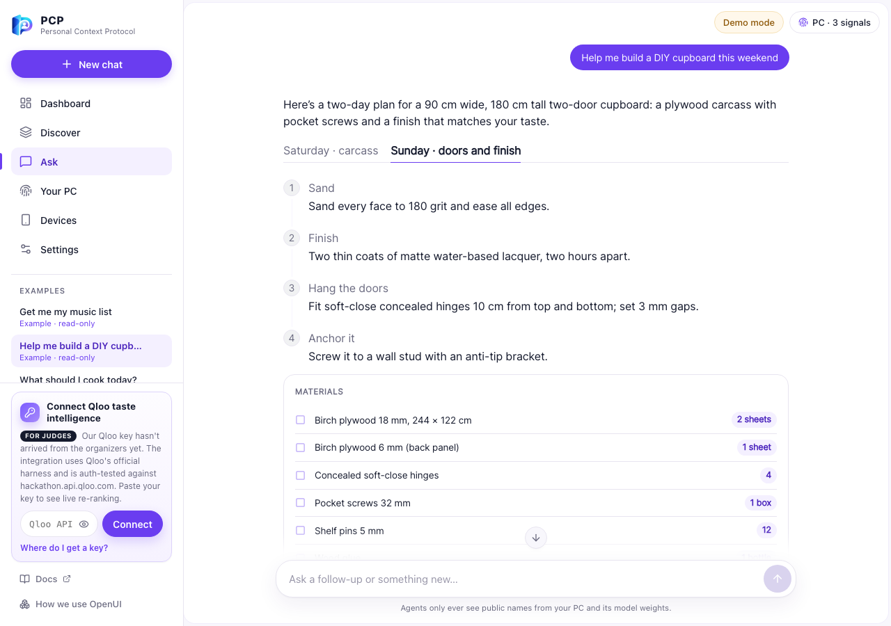
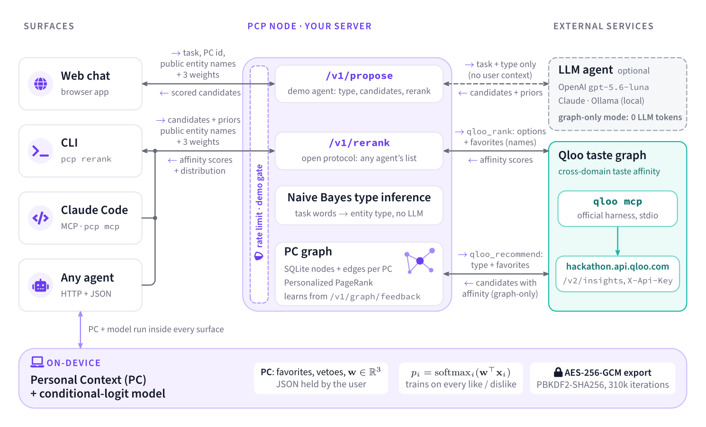
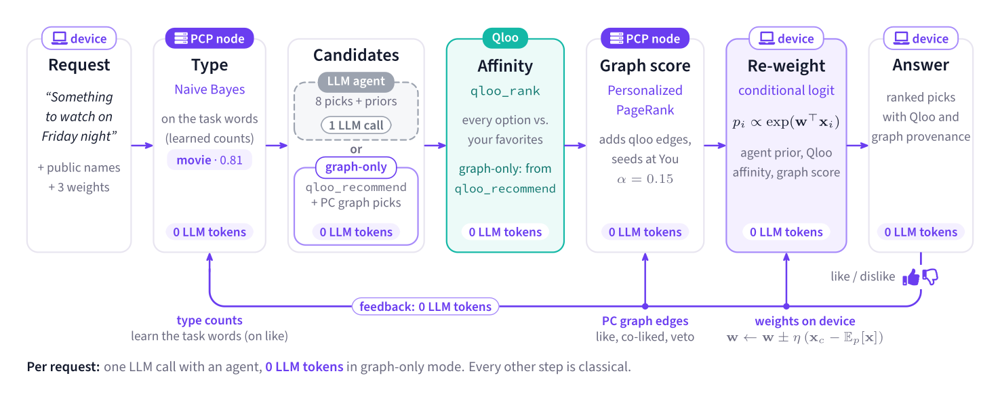
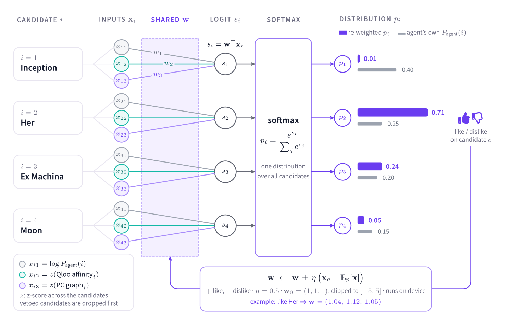
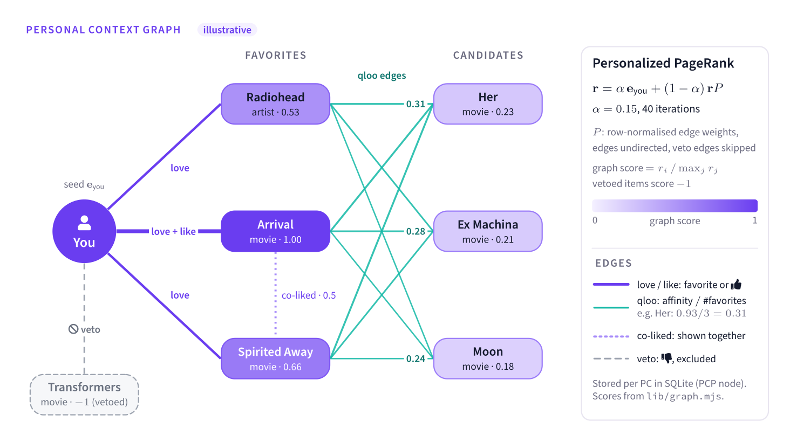
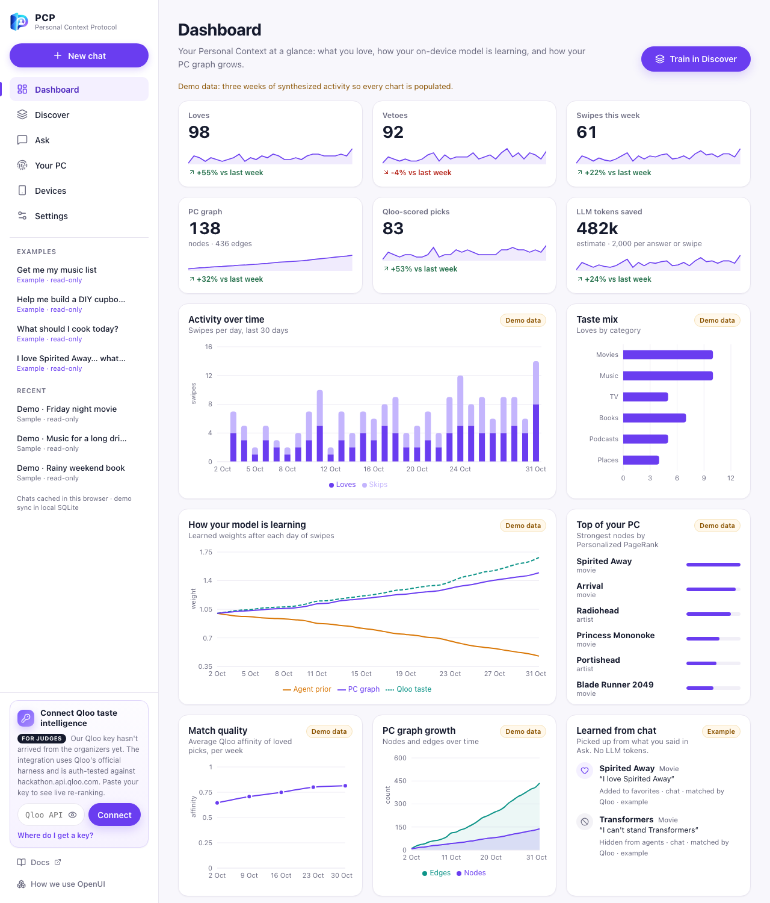
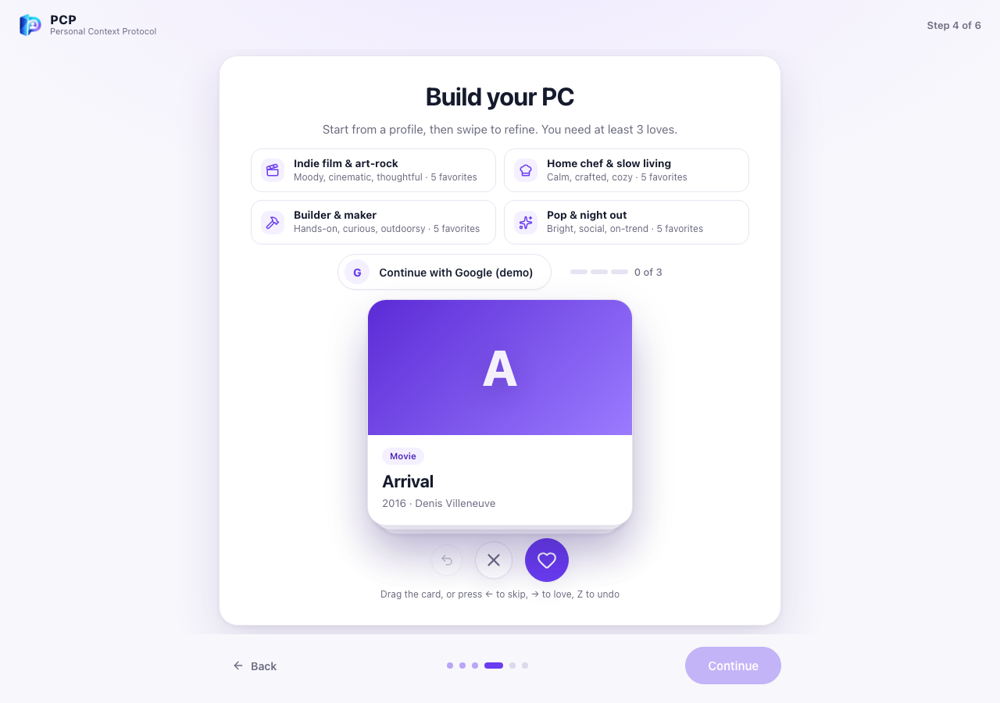
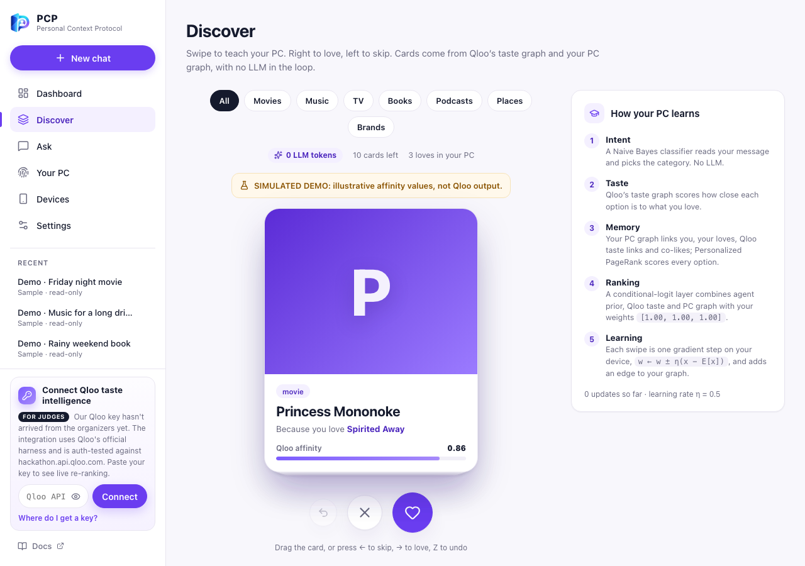
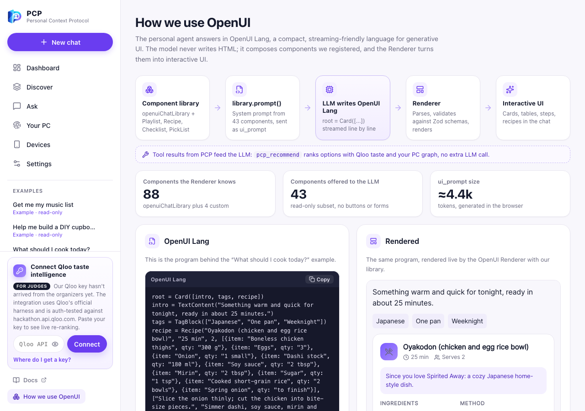

<div align="center">


# PCP · Personal Context Protocol

**Personalization solved with math, not more tokens.**

An open, agent-agnostic protocol (`pcp/0.1`) that gives any AI agent your **Personal Context (PC)**:
a portable, encrypted profile with a small model that trains on your own machine.
Taste intelligence comes from the [Qloo](https://www.qloo.com) taste graph. Ranking, memory and learning are
classical machine learning (Naive Bayes, Personalized PageRank, a conditional-logit layer), so they're
**efficient by design and private by default**.

[](LICENSE)
[](#install)
[](#option-a-docker-recommended)
[](#use-it-from-claude-code)
[](#connect-your-qloo-api-key)
[](#what-we-want-to-solve)
[](#privacy-and-security)
[](#the-protocol)



</div>

---

## Contents

- [What we want to solve](#what-we-want-to-solve)
- [System overview](#system-overview)
- [How it works](#how-it-works)
- [Install](#install)
- [Connect your Qloo API key](#connect-your-qloo-api-key)
- [Choose the agent model](#choose-the-agent-model)
- [Use it](#use-it): web chat · [CLI](#from-the-terminal-cli) · [Claude Code](#use-it-from-claude-code) · [HTTP API](#the-protocol)
- [Privacy and security](#privacy-and-security)
- [Configuration reference](#configuration-reference)
- [Troubleshooting](#troubleshooting)
- [Limitations](#known-limitations) · [Roadmap](#roadmap-the-personal-context-graph-v02) · [License](#license)

## What we want to solve

> **The industry's answer to personalization is to slap more tokens on the prompt. Ours is math.**
> A few hundred bytes of learned weights and a small graph do the job a growing memory prompt does
> today: cheaper, faster, private, and they actually get better with every interaction.

**1. Every agent meets you as a stranger.** Spotify knows your music, Netflix your films, but the assistant
you just opened knows nothing, so it falls back on generic popularity. Two people with opposite tastes
get the same list.

**2. Today's personalization is paid for in prompt tokens.** Agents "remember" you by stuffing preferences
and history into ever-longer prompts. Every request pays for that context again. Nothing is actually
*learned*: the model doesn't get better at you, it just re-reads you. And that memory is locked inside one
vendor's cloud as text you can't inspect or take with you.

**3. The alternative has been surveillance.** Ad networks solved "know the user everywhere" by tracking
people across apps. Even that is being retired: Google is winding down Privacy Sandbox's Topics API.

**PCP's answer: move personalization out of the prompt and into a small, classical, trainable layer that you
own.** Three principles:

- **Math, not tokens.** Intent, memory and ranking are closed-form or iterative math: Naive Bayes, Personalized
  PageRank and a softmax layer with one gradient step per 👍/👎. None of it calls an LLM.
- **Efficient.** For example, a 2,000-token memory block re-sent on 50 requests a day is 100,000 tokens per user per
  day. PCP adds **0** tokens: your whole model is three numbers plus a graph of a few hundred edges, and scoring a
  shortlist takes milliseconds on a laptop. Graph-only mode recommends with **no LLM call at all**.
- **Private.** Learning happens on your device. Requests carry only public entity names and three weights. There's no
  PII, exports are AES-256-GCM encrypted, phone pairing is end-to-end encrypted, and you can self-host the whole node.

| | Prompt-based memory | PCP |
| --- | --- | --- |
| Where preferences live | Vendor cloud, as prompt text | Your device and your own PCP node |
| Cost per request | Re-sends your context as tokens | **0 LLM tokens** for intent, memory and ranking |
| Learning | None (re-reads text) | Gradient step per 👍/👎, graph updates per interaction |
| Portability | Locked to one assistant | Any agent: HTTP, CLI, Claude Code (MCP) |
| Inspectability | Opaque | Explicit weights, graph and provenance |
| Taste knowledge | What the LLM memorized | Qloo's cross-domain taste graph |

The machine learning is deliberately classical, small and deterministic:

- **Intent** comes from a multinomial **Naive Bayes** classifier: "something for Friday night" becomes `movie`,
  and it learns your phrasing from your confirmed picks.
- **Memory** is a **Personal Context graph** (you, things you love, Qloo taste links, co-likes, vetoes) scored with
  **Personalized PageRank**.
- **Ranking** is a **conditional-logit** layer (a one-layer softmax network) over the agent prior, Qloo affinity
  and graph score, trained online on your device.

An LLM is optional. It only proposes candidates and words the answer. **Graph-only mode** recommends with
Qloo plus your PC graph and spends no LLM tokens at all.

## System overview

<p align="center"></p>

<p align="center"></p>

## How it works

The core is the distribution layer described in our submission. The PC graph is an additional feature
layered on top of it.

1. **Personal Context (user-held JSON).** It holds public cultural entities you love (in any category, so an artist can
   inform movie picks), vetoes, and a learned model. It contains no PII; the ID is a random pseudonym.
2. **Any agent proposes** candidate options *with its own probabilities*. In the demo the agent (OpenAI `gpt-5.6-luna`
   by default) gets no context about you, so its list is the generic baseline.
3. **Qloo scores.** One `qloo_rank` call scores every option against your taste across categories.
4. **The distribution layer re-weights.** A conditional-logit model blends the agent's prior with the Qloo
   affinity and, when available, your PC graph score:

   $$p_i = \frac{\exp(\mathbf{w}^\top \mathbf{x}_i)}{\sum_j \exp(\mathbf{w}^\top \mathbf{x}_j)},\qquad \mathbf{x}_i = \big[\log P_{\text{agent}}(i),\ z(\text{affinity}_i),\ z(\text{graph}_i)\big]$$

5. **It trains on your device.** Each 👍/👎 is one gradient step,
   $\mathbf{w} \leftarrow \mathbf{w} \pm \eta\,(\mathbf{x}_c - \mathbb{E}_p[\mathbf{x}])$, run in the browser or CLI.
   Likes become signals and dislikes become vetoes.
6. **The PC graph learns too.** Your PCP node keeps a small graph in SQLite: love and like edges from you, Qloo taste
   edges between entities (from Qloo affinities it has already seen, so fewer repeat calls), co-like edges, and
   vetoes. **Personalized PageRank** from your node gives every candidate a graph score:

   $$\mathbf{r} = \alpha\,\mathbf{e}_{\text{you}} + (1-\alpha)\,\mathbf{r}P,\qquad \alpha = 0.15$$

7. **Chat memory, without asking.** The chat never makes you pick or rate anything. A small rule-based extractor reads
   each message for preference cues ("I love…", "big fan of…", "I can't stand…") and resolves the names with Qloo's
   `qloo_describe`. A follow-up about something the agent just suggested also counts as a quiet like. Each memory
   becomes a like or veto in your PC and a graph edge, with no LLM tokens. You can see everything learned on the
   Dashboard ("Learned from chat") and turn it off in Settings.

<table>
<tr>
<td width="50%"><br><sub><b>Distribution layer</b>: a one-layer softmax network over three features, trained online.</sub></td>
<td width="50%"><br><sub><b>PC graph</b>: you, your loves, Qloo taste links and vetoes, scored with Personalized PageRank (illustrative).</sub></td>
</tr>
</table>

If Qloo can't score the options, the app says so and shows the agent's own distribution. Nothing is
faked, and that gap is the "without Qloo" comparison.

<table>
<tr>
<td width="50%"><br><sub><b>Dashboard</b>: activity over time, how your model is learning, taste mix and what was learned from chat.</sub></td>
<td width="50%"><br><sub><b>Onboarding</b>: start from a taste profile, try the labeled Google demo, or swipe to build your PC.</sub></td>
</tr>
<tr>
<td width="50%"><br><sub><b>Discover</b>: swipe to train (Qloo + PC graph, 0 LLM tokens).</sub></td>
<td width="50%"><br><sub><b>How we use OpenUI</b>: the agent writes OpenUI Lang, which the renderer turns into UI.</sub></td>
</tr>
</table>

<sub>Screenshots use the labeled demo mode (<code>?demo=1</code>): <i>"SIMULATED DEMO: illustrative affinity values, not Qloo output."</i></sub>

## Install

You need **Node.js 22.19+** (or Docker), a **Qloo API key**, and a key for **one agent model** (OpenAI,
Anthropic, or a local Ollama model).

### Option A: Docker (recommended)

```sh
git clone https://github.com/ZYLIM0702/personal-context-protocol
cd personal-context-protocol
cp .env.example .env          # add QLOO_API_KEY and OPENAI_API_KEY (see below)
docker compose up -d --build  # http://127.0.0.1:8787
```

The image includes the official Qloo harness (`@qloo/qloo-harness`), runs as a non-root user, has a
healthcheck, and keeps its data (encrypted vault backups and the demo SQLite history) in a named volume. The
port is bound to `127.0.0.1`; expose it with a reverse proxy or a tunnel (for example
`cloudflared tunnel --url http://127.0.0.1:8787`), and set `PCP_TRUST_PROXY=1` so rate limiting sees visitor IPs.

### Option B: Node.js

```sh
npm install --global @qloo/qloo-harness   # official Qloo harness (provides `qloo mcp`)
git clone https://github.com/ZYLIM0702/personal-context-protocol
cd personal-context-protocol
npm install
cp .env.example .env                      # add QLOO_API_KEY and OPENAI_API_KEY
npm start                                 # http://127.0.0.1:8787
```

### Option C: Install the `pcp` command globally

```sh
npm install --global @qloo/qloo-harness
npm install --global github:ZYLIM0702/personal-context-protocol
pcp help
```

See [docs/cli.md](docs/cli.md) for every command.

## Connect your Qloo API key

1. **Get a key.** Hackathon participants request one through the
   [Qloo hackathon developer guide](https://docs.qloo.com/reference/qloo-llm-hackathon-developer-guide).
   Keys arrive by email (check spam).
2. **Connect it in one of these ways** (the first one found wins):

   | Method | How | Best for |
   | --- | --- | --- |
   | `.env` file | `QLOO_API_KEY=your-key` in `.env` | Local runs and Docker |
   | Qloo harness config | `qloo setup --qloo` (hidden prompt, stored in the harness's private config) | Local machines, keeps the key out of project files |
   | Container env | `docker run -e QLOO_API_KEY=… …` or a secret manager | Servers and CI |
   | Per-tab key (fallback) | Settings → **Connect Qloo** in the web app; shown only when the server has no key | Reviewers trying a hosted demo |

3. **Host is handled for you.** Hackathon keys only work on `https://hackathon.api.qloo.com`, and the
   harness trusts only the production host by default. The server passes `QLOO_BASE_URL` and
   `QLOO_TRUSTED_BASE_URL` (both defaulting to the hackathon host) to `qloo mcp` on every call. Authentication
   uses the `X-Api-Key` header inside the harness; the key is never sent to the browser.
4. **Verify.**

   ```sh
   qloo setup --status          # harness readiness (no network call)
   qloo doctor                  # local checks
   curl -s http://127.0.0.1:8787/api/status   # "qloo_ready": true
   ```

   In the web app, the Qloo indicator in Settings turns green.

> **About the per-tab key.** It lives only in that tab's memory (no storage or cookies), is sent over
> HTTPS with each request in the `x-qloo-api-key` header, is passed to one `qloo mcp` process, and is never
> stored or logged. Qloo's kit recommends keeping credentials out of browser apps, so prefer a server-side key.

## Choose the agent model

The agent is model-agnostic. Set at least one in `.env`; the default is the first one configured
(`LLM_BASE_URL`, then OpenAI, then Anthropic). Users can switch per request in Settings.

| Provider | `.env` | Default model |
| --- | --- | --- |
| OpenAI | `OPENAI_API_KEY` (optional `OPENAI_MODEL`, `OPENAI_BASE_URL`) | `gpt-5.6-luna` |
| Anthropic | `ANTHROPIC_API_KEY` (optional `ANTHROPIC_MODEL`) | `claude-sonnet-5-5` |
| Local (Ollama / LM Studio) | optional `OLLAMA_BASE_URL`, `OLLAMA_MODEL` | `llama3.2` |

Model keys stay on the server. A client-supplied base URL is only honored for `localhost` unless
`PCP_ALLOW_CUSTOM_BASE_URL=1` (SSRF guard), and the server's key is never sent to a remote host chosen by a client.

## Use it

### In the browser

The web app (Next.js + [OpenUI](https://github.com/thesysdev/openui)) has six pages: **Dashboard** (your PC at a glance, with
activity and learning trends), **Discover** (swipe to train, 0 LLM tokens), **Ask** (your personal agent), **Your PC**,
**Devices** (QR pairing) and **Settings**. New browsers go through a short onboarding; you can start from a ready-made
taste profile, the labeled Google demo, or swiping.

**How we use OpenUI.** The app defines a component library (OpenUI's chat library plus our own pick-list, playlist
and recipe components). `library.prompt()` turns it into a spec the LLM follows, so the personal agent answers in
**OpenUI Lang**, a compact, streaming-friendly UI language, and the OpenUI renderer turns that into interactive cards,
tables and checklists. Taste-dependent parts come from the `pcp_recommend` tool (Qloo + your PC graph). Every answer
has a "View OpenUI Lang" toggle.

Open `http://127.0.0.1:8787`. Swipe through the onboarding cards (or try the labeled **Continue with Google**
demo) to build your PC, then just ask in plain words. There's no category picker, because the Naive Bayes classifier
infers it. Rate picks with 👍/👎 and watch the learned weights and your PC graph change. Turn on **Graph-only mode** in
Settings to recommend without any LLM tokens. A labeled demo is at `/?demo=1`.

### From the terminal (CLI)

```sh
export PCP_URL=http://127.0.0.1:8787 PCP_PASSPHRASE='choose-a-passphrase'   # PC file encrypted at rest
pcp add --name "Radiohead" --type artist
pcp rerank --type movie --candidates "Inception=0.5,Arrival=0.3,Her=0.2"
pcp like --name "Arrival"        # trains locally on the last rerank
pcp nope --name "Inception"      # veto + train
pcp show
```

Full reference with sample output: [docs/cli.md](docs/cli.md).

### Use it from Claude Code

PCP ships an MCP adapter, so Claude Code (or any MCP client) can re-rank its own recommendations with your
Personal Context before answering. Start your own PCP node first (`pcp serve`, or Docker), then:

```sh
npm install --global github:ZYLIM0702/personal-context-protocol
claude mcp add personal-context \
  -e PCP_URL=http://127.0.0.1:8787 -e 'PCP_PASSPHRASE=choose-a-passphrase' \
  -- pcp mcp
```

Or without a global install: `claude mcp add personal-context -- npx -y -p github:ZYLIM0702/personal-context-protocol pcp mcp`.

> The CLI and the MCP adapter always talk to **your own** PCP node (default `http://127.0.0.1:8787`) with your own
> keys. They never connect to the hosted demo page, which only serves its own web UI (see
> [Hosted demo vs your own node](#hosted-demo-vs-your-own-node)).

Tools: `pcp_status`, `pcp_add_signal`, `pcp_rerank`, `pcp_feedback`, `pcp_disclose`. Setup details, a project
`.mcp.json` and a skill: [docs/claude-code.md](docs/claude-code.md).

### The protocol

Any agent, in any language, can call the reference endpoint with its own candidates:

```http
POST /v1/rerank
x-qloo-api-key: (optional, only when the server has no key)

{
  "type": "movie",
  "candidates": [{ "name": "Arrival", "prior": 0.3 }, { "name": "Inception", "prior": 0.5 }],
  "passport": { "protocol": "pcp/0.1", "signals": [{ "name": "Radiohead", "type": "artist" }], "vetoes": [], "policy": { "weights": [1, 1, 1] } }
}
```

| Endpoint | Purpose |
| --- | --- |
| `POST /v1/rerank` | Score any agent's candidates with Qloo and return the re-weighted distribution plus provenance |
| `POST /v1/propose` | `{ task, passport, pc_id?, type?, engine?, agent? }`. Infers the type (Naive Bayes), gets candidates from the LLM agent or, with `engine: "graph"`, from Qloo `qloo_recommend` plus your PC graph (0 LLM tokens), then scores with Qloo and Personalized PageRank. Requires Qloo (a server key or an `x-qloo-api-key` header), otherwise `412` before any LLM call |
| `POST /v1/chat` | Personal agent: `{ messages, passport, pc_id, ui_prompt }`. The LLM answers in OpenUI Lang (generative UI) and calls the `pcp_recommend` tool, which is Qloo plus your PC graph with no extra LLM call, for anything taste-related |
| `POST /v1/discover` | Discovery deck: Qloo `qloo_recommend` for your top categories plus PC graph suggestions, each with a "because you love…" link. **0 LLM tokens** |
| `POST /v1/graph/signals` · `POST /v1/graph/feedback` | Train the PC graph from your favorites, vetoes and 👍/👎 (`pc_id` is a random pseudonymous UUID) |
| `GET /v1/graph/:pc_id` · `DELETE /v1/graph/:pc_id` | Inspect (top nodes, edges, PageRank scores) or reset your PC graph |
| `PUT` · `GET` · `DELETE /v1/vault/:id` | Self-hosted backup and phone pairing relay; only encrypted PC files are accepted |
| `GET/POST /v1/conversations` · `GET/PUT/DELETE /v1/conversations/:id` | Chat history, scoped per browser by the `x-pc-id` header, in local SQLite |
| `GET /api/status` | Qloo readiness, configured model providers, Google Drive client ID |

The SDK (`public/sdk/pcp.js`) is one file that runs unchanged in the browser and Node, so the web app, CLI and MCP
adapter share the exact same model: `createPassport`, `addSignal`, `disclose`, `distribution`, `feedback`,
`encryptPassport`, `importPassport`, `save`/`load` (in code, the PC document is called a `passport`).

### Hosted demo vs your own node

The public demo runs with `PCP_DEMO_PAGE_ONLY=1`. Its OpenAI and Qloo keys only answer requests from its own web
page: every `/v1/*` call needs a signed, HttpOnly, SameSite=Strict session cookie issued with the page and a
same-origin browser request. The agent model can't be changed per request, and the routes are rate-limited. The
CLI, the MCP adapter and your own agents should run **your own** node (`pcp serve` or Docker) with your own keys.

## Privacy and security

- **Minimal disclosure.** Requests carry only `disclose(passport)` (public entity names and three weights), plus a
  random pseudonymous `pc_id` when you use the PC graph on your own node.
  There's no ID, history or timestamps. No personal data is sent to Qloo.
- **On-device learning.** The model trains in the browser or CLI. No training data goes to a server.
- **Chat memory is visible and optional.** Only public entity names you mention are remembered, never your messages.
  It's listed on the Dashboard and can be switched off in Settings.
- **Encryption.** Exports, CLI files (with `PCP_PASSPHRASE`) and backups are sealed with **AES-256-GCM**, using a
  key derived from your passphrase with PBKDF2-SHA256 (310,000 iterations).
- **Bring your own storage.** Encrypted backups can go to this device, your own server (`/v1/vault`, which only
  accepts ciphertext), or Google Drive's hidden app folder (in the browser, with `GOOGLE_CLIENT_ID`).
- **Keys stay server-side.** Qloo and model keys live in `.env` or the harness config, never in the browser
  bundle. Qloo is only called through the official `qloo mcp` harness, which receives only its own `QLOO_*`
  settings (model keys are not passed to it).
- **Quota protection.** Routes that call Qloo or a model are rate-limited per client (`PCP_RATE_LIMIT`), and
  identical Qloo requests are cached for 10 minutes. Cross-origin browser access is off unless `PCP_CORS_ORIGINS` is set.
- **Chat history.** Cached in your browser and synced to a local SQLite file (`data/demo.sqlite`), scoped per browser
  by your random PC ID, so visitors never see each other's chats. Your PC and its on-device model never go there.
- **Phone pairing.** The Devices page shows a QR code. Your PC is encrypted in the browser with a fresh random key and
  relayed once through `/v1/vault`; the key travels only in the QR code's URL fragment (`#pair=…`), which browsers never
  send to the server. The phone decrypts it, imports it and deletes the relay copy.

## Configuration reference

| Variable | Default | Purpose |
| --- | --- | --- |
| `QLOO_API_KEY` | — | Qloo credential (or use `qloo setup --qloo`) |
| `QLOO_BASE_URL` | `https://hackathon.api.qloo.com` | Qloo host passed to `qloo mcp` |
| `QLOO_TRUSTED_BASE_URL` | same as `QLOO_BASE_URL` | Tells the harness to trust that host |
| `OPENAI_API_KEY` / `OPENAI_MODEL` / `OPENAI_BASE_URL` | — / `gpt-5.6-luna` / OpenAI | OpenAI or compatible agent (the default agent) |
| `ANTHROPIC_API_KEY` / `ANTHROPIC_MODEL` | — / `claude-sonnet-5-5` | Anthropic agent |
| `OLLAMA_BASE_URL` / `OLLAMA_MODEL` | `http://localhost:11434/v1` / `llama3.2` | Local agent |
| `LLM_BASE_URL` / `LLM_MODEL` / `LLM_API_KEY` | — | Server-wide OpenAI-compatible default |
| `PCP_ALLOW_CUSTOM_BASE_URL` | off | Allow non-localhost client base URLs |
| `PCP_DEMO_PAGE_ONLY` | off | Hosted demo: `/v1/*` only answers the server's own web page (signed session cookie + same-origin), and the agent model is fixed |
| `PCP_DATA_DIR` | `./data` (`~/.pcp/data` for `pcp serve`) | SQLite PC graph, chat history and vault |
| `GOOGLE_CLIENT_ID` | — | Enables Google Drive backup in the browser |
| `PCP_RATE_LIMIT` | `20` | Requests per minute per client on Qloo/model routes |
| `PCP_TRUST_PROXY` | off | Use `CF-Connecting-IP` / `X-Forwarded-For` for the client IP (set behind a tunnel or proxy) |
| `PCP_CORS_ORIGINS` | same-origin only | Comma-separated origins (or `*`) allowed to call the API from a browser |
| `PORT` / `HOST` | `8787` / `127.0.0.1` (`0.0.0.0` in Docker) | Listen address |

## Troubleshooting

| Symptom | Fix |
| --- | --- |
| Qloo shows **not connected** | Set `QLOO_API_KEY` in `.env` (or run `qloo setup --qloo`) and restart. Check with `curl /api/status`. |
| `QLOO_AUTH` / `401 Unauthorized` | The key is wrong or expired, or it's being used on the wrong host. Hackathon keys only work on `hackathon.api.qloo.com` (the default). |
| `qloo: command not found` | `npm install --global @qloo/qloo-harness`, then open a new terminal (the Docker image already includes it). |
| `429 Too many requests` | This server's per-client limit (`PCP_RATE_LIMIT`). Behind a tunnel, set `PCP_TRUST_PROXY=1` so all visitors don't share one limit. |
| Qloo rate limited | Wait and retry later; the app never retries automatically. Ask Qloo support for more headroom. |
| "Qloo couldn't match: …" | Qloo couldn't resolve that title or favorite. The rest are still ranked; rephrase or pick one of the suggested matches. |
| `Set OPENAI_API_KEY in .env…` | Add a model key for the selected provider, or switch provider in Settings. |
| Ollama unreachable | Start Ollama (`ollama serve`) and pull the model (`ollama pull llama3.2`). |

## Qloo integration

| Qloo tool (via `qloo mcp`) | Why |
| --- | --- |
| `qloo_rank` | Scores an agent's own shortlist (`options`, `option_type`) against your taste `signals` in one call. That is exactly the re-weighting job. |
| `qloo_capabilities` | Checks readiness without using quota. |

**Entity resolution.** `qloo_rank` resolves every option and signal name to a Qloo entity before calling
`/v2/insights` (`filter.type`, `filter.results.entities`, `signal.interests.entities`). Results are joined back
to the agent's titles by Qloo **entity ID**, not by name, and the matched Qloo name is shown when it differs.
If any input can't be resolved (`needs_input`), the server drops just those inputs, re-ranks the rest once, and
returns them as `unresolved` with Qloo's suggested candidates so the user can correct them. Scores are labeled
as Qloo **affinity**, or as **rank** when Qloo returns an order without an affinity value. Tags and audiences are
not used. Video games are excluded until the harness and the guide agree on the entity type
(`videogame` vs `video_game`).

Follows the [hackathon developer guide](https://docs.qloo.com/reference/qloo-llm-hackathon-developer-guide)
and the official [hackathon kit](https://github.com/qloo/qloo-hackathon-kit): the hackathon host, `X-Api-Key`
auth through the harness, `/v2/insights` (no legacy endpoints), server-side keys and aggregate data only.

## Known limitations

- The harness result schema is still a preview (`1.0-preview.1`). The parser reads the affinity defensively and
  falls back to Qloo's rank order.
- Qloo affinities are aggregate signals, not claims about any individual.
- The model has 3 weights. It demonstrates the mechanism, not production accuracy.
- The browser copy of your PC lives in `localStorage` unencrypted. Exports, CLI files and backups are encrypted.
- The PC graph is stored unencrypted in SQLite on your own PCP node. Self-host it; the hosted demo is for trying the UI.
- The Naive Bayes intent classifier covers 8 categories with a small seed vocabulary. Use "change" in the UI to correct it, and it learns.
- The server sees the disclosed public entity names it needs for the Qloo call, so self-host it for full control.

## Roadmap: the Personal Context Graph (v0.2)

- **Graph model.** Nodes for entities (Qloo), topics, moods and contexts; weighted edges learned on the device by local agents.
- **Context-aware policies.** Different weights for focus and relaxing, weekday and weekend.
- **Encrypted sync across devices**, including a Chrome extension (`chrome.storage.sync`).
- **Consent-based connectors** that run on the device and add only public cultural entities.

## License

[MIT](LICENSE)
